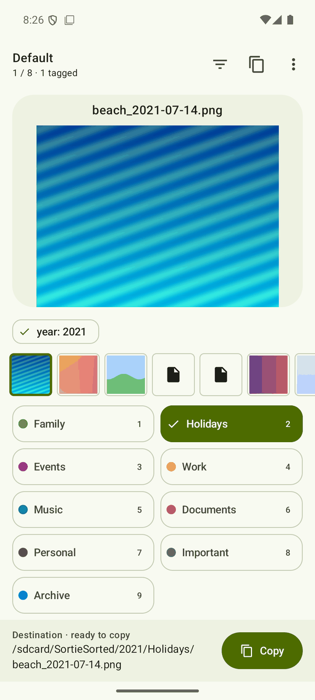
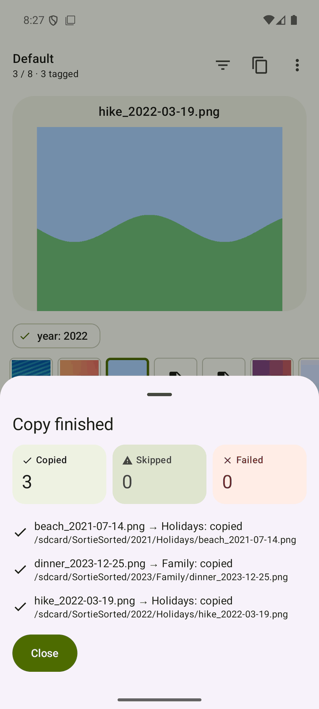
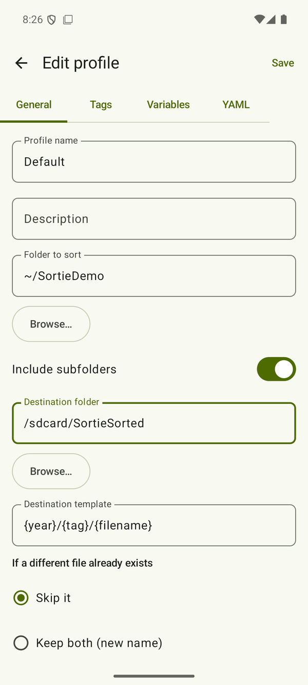

# Sortie

Classify files with tags and copy them into folders you define, by default `year/tag`, but any layout built from
data taken from the file name, folder or metadata (artist, client, month...). Originals are never moved, changed or
deleted. One product, two apps with the same features:

| | Folder | Stack | Docs |
|---|---|---|---|
| **Desktop** (Linux) | [`desktop/`](desktop/) | Go + Fyne | [desktop/README.md](desktop/README.md) |
| **Android** | [`android/`](android/) | Kotlin, Jetpack Compose | [android/README.md](android/README.md) |

Both apps share the version number (`VERSION`) and the **profile** format: a YAML file describing one use case
(folders, tags, variables, templates) that you can copy between phone and computer. See
[docs/PROFILES.md](docs/PROFILES.md) and the examples in [docs/profiles/](docs/profiles/).

## Screenshots

<p>
  
  
  
</p>

More in [android/README.md](android/README.md#screenshots).

## Quick start

Only Docker and `make` are needed on the host; every build runs in a container.

```bash
make help              # list the targets
make image             # build the dev images (once)
make check             # version check + desktop checks + android tests and lint
make desktop-run       # run the desktop app (needs a display)
make android-debug     # build the debug APK (android/app/build/outputs/apk/debug)
make android-install   # install it on a connected device or emulator
```

Releases: `make desktop-release` (validated Linux tarball in `desktop/release/`) and `make android-release`
(signed APK and AAB, see [android/README.md](android/README.md)). Pushing a tag `vX.Y.Z` that equals `VERSION`
runs `.github/workflows/release.yml`: it builds both apps and publishes one GitHub Release with the desktop tarball, the signed APK/AAB and checksums.

## Layout

```
VERSION            single version for both apps
docs/              shared profile format reference and example profiles
scripts/           repo-level scripts (version check)
desktop/           Go desktop app, Dockerfile.dev, release scripts, packaging
android/           Android app (Gradle: :app and :core), Dockerfile, app.properties
.github/workflows/ ci.yml (checks), release.yml (one release for both apps)
```

## Versioning and parity

Features and version move together: a user-visible change lands in both apps, and `VERSION` is read by both builds.
Each app keeps its own changelog ([desktop](desktop/CHANGELOG.md), [android](android/CHANGELOG.md)). The rules,
for people and AI agents, are in [AGENTS.md](AGENTS.md); contribution notes in [CONTRIBUTING.md](CONTRIBUTING.md).

## License

[MIT](LICENSE).
