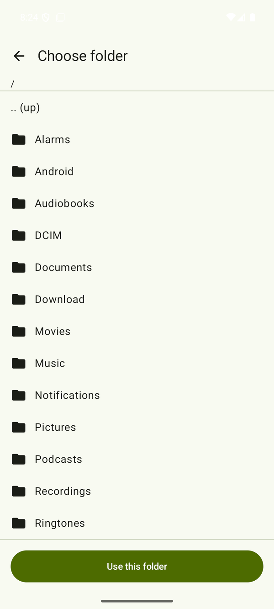
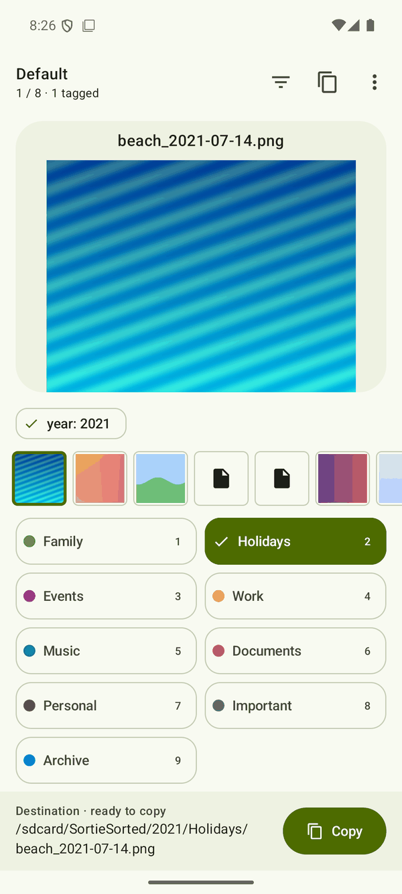
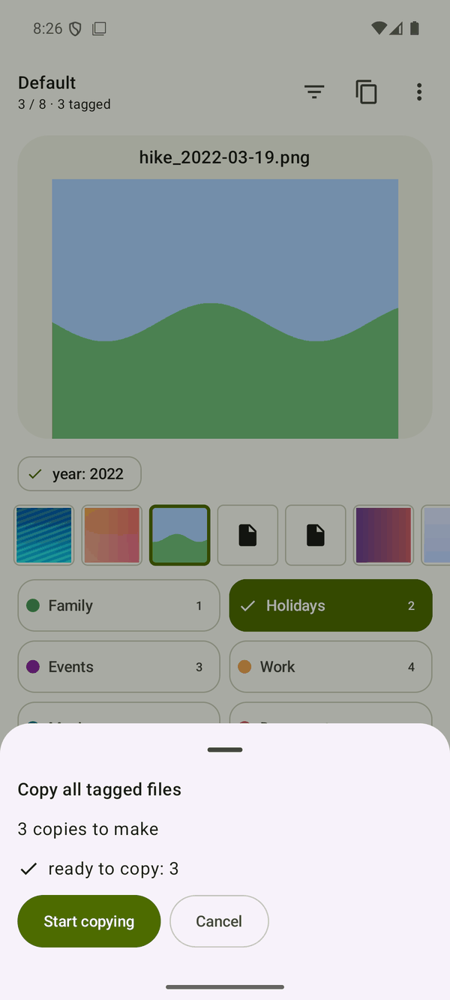
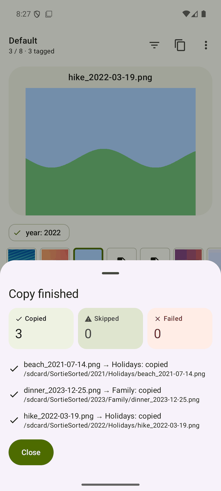
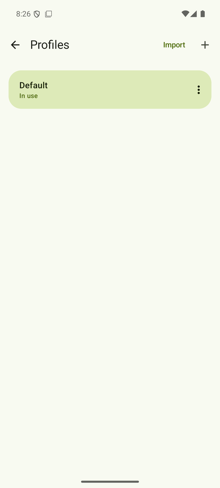
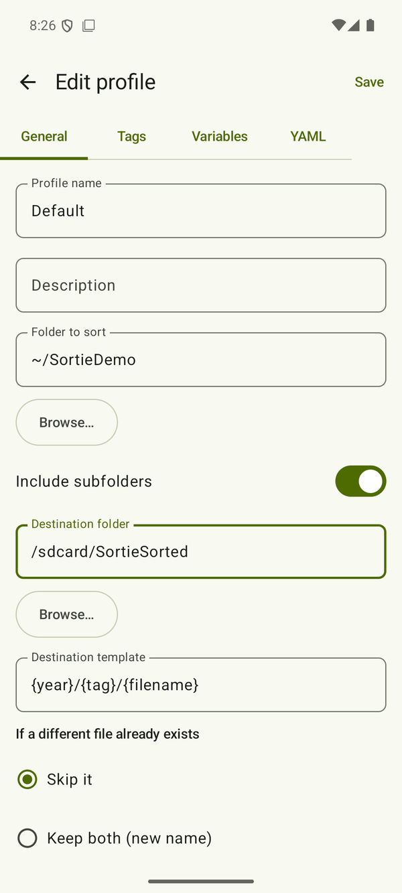

# Sortie

An Android app that sorts files into folders with tags. It is the phone version of the desktop Sortie:
you look at the files of a folder one by one, tag them, and the app **copies** them into a destination folder
built from a template such as `{year}/{tag}/{filename}`. Your originals are never moved, changed or deleted.

Native Android (Kotlin, Jetpack Compose, Material 3). Everything builds inside Docker; nothing but Docker
(and `make`) is needed on the host.

## What it does

- **Profiles** hold one use case: the folder to sort, the destination folder, the tags, the variables and the
  destination template. They are plain YAML files, compatible with the desktop app: import one from the
  desktop, or export one to it. Profiles are edited in forms or as raw YAML (errors show the line number).
- **Sorting**: swipe through the files (or use the arrow keys of a hardware keyboard), tap tags to assign them.
  Each assigned tag shows where the file would go and whether that is ready, already copied, or a conflict.
- **Variables** such as `{year}` or `{event}` come from the file name, the path, the file's metadata (EXIF,
  audio and video tags, PDF page count), its modification time, a constant, or a value you type by hand.
- **Filters** narrow the list to untagged, tagged, unresolved, ready, already copied, conflicting or failed files.
- **Copying** is write-safe: a temporary file is written next to the target, flushed to disk, read back and
  checked with SHA-256, and only then moved into place without overwriting. A conflict is skipped, kept under a
  new name, or replaced (after a confirmation). Big batches run in a foreground service with a notification, so
  they continue when you leave the app, and they can be cancelled without leaving partial files.
- **History** lists every copy of a file. A copy interrupted by a crash or a kill is marked as interrupted, and
  leftover temporary files are reported (and removed only if you ask).
- **Previews** for images (with EXIF rotation), text, PDF (first page), audio (cover, tags, playback), video
  (frame) and other files (details, "Open with").
- English and Spanish.

## Screenshots

Taken on an Android 16 emulator (1080×2400) with a few demo files.

<table>
  <tr>
    <td align="center"><br>Choose the folder to sort</td>
    <td align="center"><br>Tag a file; the bar shows where it will go</td>
    <td align="center"><br>Confirm the copies</td>
  </tr>
  <tr>
    <td align="center"><br>Results: copied, skipped, failed</td>
    <td align="center"><br>Profiles</td>
    <td align="center"><br>Edit a profile</td>
  </tr>
</table>

## Permissions

The app works with real paths, so it asks for **All files access** (`MANAGE_EXTERNAL_STORAGE`) on Android 11+
(storage permissions on Android 8–10). It has no `INTERNET` permission. Because of that permission it is meant
for APK distribution (GitHub releases), not Google Play. Notifications are requested once, for the copy
progress.

## Known differences from the desktop app

- PDF title and author are not read; only the page count is available as metadata.
- Regular expressions use Java syntax, not Go RE2. Normal patterns behave the same.
- Saving a profile from the forms drops its YAML comments (renaming or duplicating a profile keeps them, and so
  does saving from the YAML editor).
- On shared storage the "never overwrite" move is a check followed by a move, not one atomic step.
- Shortcut keys need a hardware keyboard; on touch the tags are buttons. The configurable shortcut map, the
  log file and the desktop-only commands (`--self-test`, editor launching) are not ported.

## Commands

```bash
make image      # build the dev image (once, and after Dockerfile changes)
make check      # unit tests and lint
make debug      # debug APK
make install    # install on a device/emulator
make release    # signed APK and AAB (needs signing, see below)
make help       # every target
```

Without `make`: `docker compose run --rm dev ./gradlew :core:test testDebugUnitTest lint`.
CI runs the same targets with `RUN=` (no Docker wrapper).

## App parameters

The name, id and URL are build parameters. Precedence: `-P` Gradle property, then environment variable, then the
tracked `app.properties`, then the default in `app/build.gradle.kts`.

| Parameter | `app.properties` |
|---|---|
| `APP_NAME` | `Sortie` |
| `APP_ID` | `io.github.desvelao.sortie` |
| `APP_URL` | `https://github.com/Desvelao/sortie` |
| `APP_VERSION_NAME` / `APP_VERSION_CODE` | not set: derived from the repo-root `VERSION` (code = major*10000 + minor*100 + patch) |

```bash
APP_NAME="My App" APP_ID=com.example.myapp make debug
```

## Release signing

Create a keystore inside the container (kept out of git) and `keystore.properties`:

```bash
docker compose run --rm dev bash -c '
  PW=$(head -c 24 /dev/urandom | base64 | tr -dc A-Za-z0-9 | head -c 24)
  keytool -genkeypair -keystore release.jks -alias release -keyalg RSA -keysize 4096 -validity 10000 \
    -dname "CN=Release" -storepass "$PW" -keypass "$PW"
  printf "storeFile=release.jks\nstorePassword=%s\nkeyAlias=release\nkeyPassword=%s\n" "$PW" "$PW" > keystore.properties'
```

Or pass `SIGNING_KEYSTORE`, `SIGNING_STORE_PASSWORD`, `SIGNING_KEY_ALIAS`, `SIGNING_KEY_PASSWORD` as environment
variables. A release build without signing details fails on purpose. Back up the keystore: losing it means you
cannot update an installed app.

## Releases

`.github/workflows/release.yml` tests, signs and builds the app on GitHub (together with the desktop tarball) and publishes one GitHub Release for both apps.

1. Add repository secrets: `SIGNING_KEYSTORE_BASE64` (`base64 -w0 release.jks`), `SIGNING_STORE_PASSWORD`,
   `SIGNING_KEY_ALIAS`, `SIGNING_KEY_PASSWORD`.
2. Move the `Unreleased` entries in `CHANGELOG.md` under a new `## [x.y.z] - date` heading.
3. Tag and push: `git tag v1.2.3 && git push origin v1.2.3`. Pre-release tags (`v1.2.3-rc.1`, `-beta.N`, `-alpha.N`)
   create a GitHub pre-release.

Release tags use `versionCode = major*10000 + minor*100 + patch` and `versionName` `1.2.3+<sha>`.
